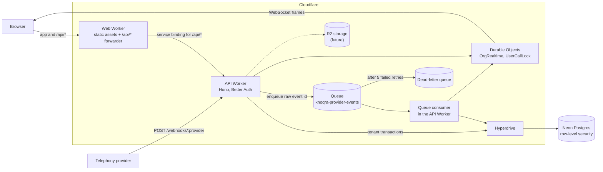
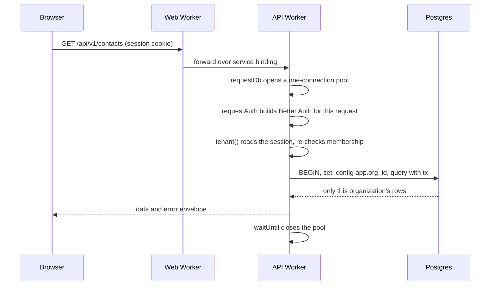
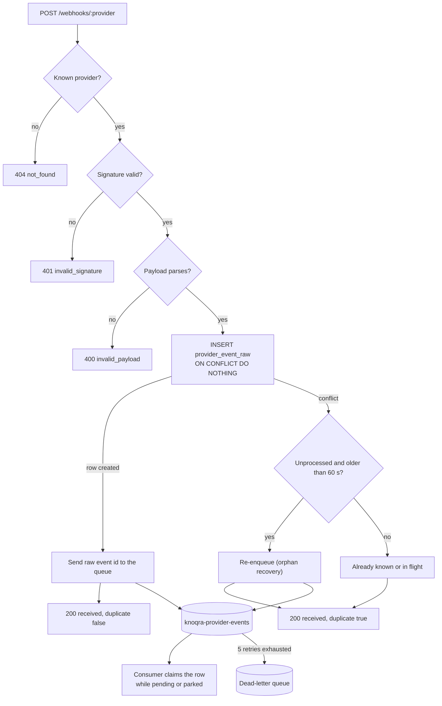
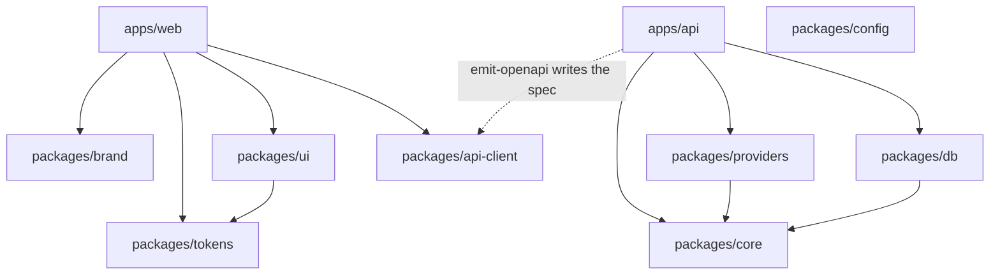

# Architecture

This document describes what exists in the repository today (milestones M0, M1, M2, M3 and M5). Parts that arrive later are marked as future. How the open-source core and KNOQRA's hosted edition fit together is in [EDITIONS.md](../EDITIONS.md).

## System overview



- The **web Worker** (`apps/web`) serves the built single-page app from static assets. Only `/api/*` runs the Worker script, which forwards it to the API Worker over the `API` service binding. Everything else is a static asset, with unknown paths falling back to `index.html`.
- The **API Worker** (`apps/api`) is one Hono app (`src/app.ts`, a pure module with no `cloudflare:*` imports so Node scripts can load it) plus the queue consumer, exported together from `src/index.ts`.
- `/webhooks/*` is deliberately **not** proxied by the web Worker. Providers call the API Worker's own domain.
- **Hyperdrive** gives the API Worker pooled Postgres connections. Locally, `wrangler.jsonc` points the binding at the docker Postgres, and `DATABASE_URL` can override it.
- **Durable Objects** carry realtime fan-out (`OrgRealtime`) and the one-call-per-user lock (`UserCallLock`); see [Durable Objects](#durable-objects). **R2** (recordings and imports) is not built yet.

## Request lifecycle



1. `requestDb` (`lib/db.ts`) opens a Postgres pool of one connection for the request and closes it after the response, because Workers I/O objects cannot be shared across requests.
2. `requestAuth` builds a Better Auth instance for the request, because secrets and the database handle are per-request bindings. `/api/auth/*` is handled by Better Auth directly.
3. `tenant()` (`middleware/tenant.ts`) is mounted on `/api/v1/*`. It reads the session, then **re-checks membership** of the active organization in the `member` table on every request, so a removed member loses access immediately. It answers `401 unauthenticated` without a session and `409 no_active_org` without a valid membership, and otherwise sets `tenant` (`orgId`, `userId`, `role`) on the context.
4. Route handlers read and write tenant data only through `withTenant(db, orgId, tx => ...)`.
5. `/api/v1/*` responses use the envelope `{ data, error }`. Validation failures become `400 validation_error`, unknown routes `404 not_found`, and unexpected errors `500 internal_error` with no detail leaked.

The OpenAPI document comes from the same route definitions: the API serves it at `/api/openapi.json`, and `pnpm api:generate` writes it to `packages/api-client/openapi.json` and regenerates the typed client.

## Tenancy model

Every tenant-owned table has an `organization_id text not null` column. Isolation is enforced by Postgres, not only by application code.

- **`withTenant(db, orgId, fn)`** (`packages/db/src/tenant.ts`) opens a transaction and runs `select set_config('app.org_id', <orgId>, true)`. The `true` makes the setting transaction-local, so it never leaks to the next transaction on a pooled connection. Blank ids and ids with surrounding whitespace are rejected, never trimmed.
- **Inside the callback, use `tx`, never `db`.** The request pool has a single connection, so touching `db` while a transaction holds it would wait forever.
- **Row-level security** is both `ENABLE`d and `FORCE`d on every tenant table: `contact`, `audit_event`, `contact_permission_event`, `timeline_event` and `contact_duplicate_dismissal`, the M5 and M3 tables below, and from M2 `provider_credential`, `call`, `call_event`, `voicemail`, `wallet` and `ledger_entry` (`packages/db/sql/rls.sql`, applied after every migration). `FORCE` makes the policy apply even to the table owner.
- **The policy** is `organization_id = NULLIF(current_setting('app.org_id', true), '')`, for both `USING` and `WITH CHECK`. A missing setting means no rows. After a transaction-local `set_config` commits, the setting reverts to `''` rather than `NULL`, so `NULLIF` turns that into `NULL`, which matches nothing.
- **A `CHECK (organization_id <> '')`** on each tenant table means an empty string can never be stored as a tenant.
- **The runtime role is `knoqra_app`**: `LOGIN`, `NOSUPERUSER`, `NOBYPASSRLS`. Superusers and `BYPASSRLS` roles ignore row-level security, so the app never connects as the owner. Migrations use the admin role through `MIGRATION_DATABASE_URL`, and `rls.sql` grants table privileges (and default privileges for future tables) to `knoqra_app`. The API test setup fails the run if `DATABASE_URL` does not connect as `knoqra_app`.
- **History tables are append-only for the runtime role.** `rls.sql` revokes `UPDATE` and `DELETE` on `contact_permission_event`, `timeline_event` and `audit_event` from `knoqra_app`, then grants `UPDATE (contact_id)` on the first two, because a merge re-points history to the surviving contact. Foreign-key cascades still run, since referential actions use the table owner. A new history table must be added to that `REVOKE` list. The one exception is account deletion: `knoqra_close_workspace()` (SECURITY DEFINER, callable only inside the workspace's tenant transaction while the closing user is its sole member) deletes a closed workspace's data and keeps its money records; a new tenant table that holds personal data must be added to it.
- **Tenant-scoped foreign keys.** `contact` has `UNIQUE (organization_id, id)`, and every table that points at a contact uses the composite key `(organization_id, contact_id)`. Foreign-key checks bypass row-level security, so a single-column key could link a row to another tenant's contact. `contact.merged_into_id` is a composite key too, with `ON DELETE SET NULL (merged_into_id)`. It is raw SQL in migration 0003 because Drizzle cannot express it, so never add `.references()` to that column in the schema.
- **Tables without RLS, on purpose:** Better Auth's own tables (`user`, `session`, `account`, `verification`, `organization`, `member`, `invitation`, `two_factor`) are read by Better Auth outside any tenant context, so isolation there lives in application code (the membership re-check). `user_prefs` has no `organization_id` either: it is keyed by user id and only ever read through the session's user id. `provider_event_raw`, `call_route` and `provider_number_route` are system tables, because webhooks are stored and routed before the owning organization is known. `instance_license` is a one-row system table holding a self-hosted instance's license key, which belongs to the whole instance ([licensing.md](licensing.md)). Never expose them through tenant queries.
- **Hyperdrive query caching is disabled; cached SELECTs would ignore the per-transaction tenant context and auth revocation.** Create every Hyperdrive config with `--caching-disabled` (`pnpm knoqra deploy` does; see [self-host.md](self-host.md)).
- **Audit rows outlive their subjects.** `audit_event` has no foreign key to `organization`. Denied and not-found reads are audited too, in their own tenant transaction.

Messaging adds tenant tables with the same policy (see [Messaging](#messaging-m3)). IDs for KNOQRA tables are text in the form `<prefix>_<32 hex>` (`ct` contact, `cp` consent event, `te` timeline event, `dd` duplicate dismissal, `ae` audit event, `pe` provider event, `tk` task, `nt` notification, `od` Otto draft, `ue` usage event, `cc` channel connection, `cr` channel route, `cv` conversation, `mg` message, `ms` message status event, `mt` message template, `pc` provider credential, `cl` call, `ce` call event, `vm` voicemail, `wl` wallet, `le` ledger entry). Better Auth tables keep Better Auth's own ids.

### Authentication

Better Auth 1.7.20 is mounted at `/api/auth/*` with email and password and the `organization`, `twoFactor` and Expo plugins. A personal workspace (`ws-<user id>`) is created idempotently when a user signs up, and again on sign-in if a user is somehow left without one. The web app and the API share one origin through the service binding, so cookies are first-party, and `BETTER_AUTH_URL` is the web origin.

Hardening that matters when you change auth code:

- **Passwords need at least 12 characters.** The mobile app mirrors this limit, so change both together.
- **A password reset signs out every other session** (`revokeSessionsOnPasswordReset`). The reset email is sent in a background task, so the response time does not show whether an address has an account.
- **Organization endpoints are locked down.** One personal workspace per user, so `allowUserToCreateOrganization` is `false` and every `/api/auth/organization/*` path is disabled (404 for any method) except `set-active`, `get-full-organization` and `list`, which the Desk uses. The blocked list is `BLOCKED_ORGANIZATION_PATHS` in `apps/api/src/auth/auth.ts`. A drift test fails when the plugin registers a path that is neither blocked nor allowed, so a Better Auth upgrade cannot quietly expose a new one. Re-enable these paths deliberately when teams arrive in Phase 2.
- **Display names follow the API's text rules.** `/api/auth/update-user` is disabled too (`BLOCKED_AUTH_PATHS`), so a name changes only through `PATCH /api/v1/me`. Better Auth `databaseHooks.user.create.before` and `user.update.before` check any name it writes with the same `safeText({ min: 1, max: 120 })` rule and answer 400 otherwise, so sign-up cannot store a 200,000-character name or send a NUL byte to Postgres.
- **Trusted origins.** The web origin and the mobile `knoqra://` scheme are trusted. `exp://` origins (Expo Go) are trusted only when `APP_ENV=development` and `BETTER_AUTH_URL` is a localhost address, and a guard fails every auth request if `NODE_ENV=development` is set for a deployed environment.
- **Rate limiting** is on only in deployed Workers (not local dev or tests) and keys on `cf-connecting-ip`, never `x-forwarded-for`, which clients can spoof. The durable limit is the Workers Rate Limiting binding `RL_AUTH` (10 per 60 s per address and route on sign-in, sign-up, password reset and two-factor verify), applied in `apps/api/src/lib/rate-limit.ts` before the database is opened. Dialing, voice tokens and message sending have their own bindings (`RL_DIAL`, `RL_VOICE_TOKEN`, `RL_MESSAGE_SEND`, declared by the generated `wrangler.selfhost.jsonc`). Better Auth's in-memory limiter stays on as well, but it counts per isolate only.
- **Free text goes through `safeText`** (`apps/api/src/lib/schemas.ts`), which rejects NUL and other control characters with a 400. Postgres text cannot hold NUL, so skipping it would be a 500.

## Contacts, consent and timeline (M1)

### Tables

| Table | Tenant (RLS) | What it holds |
| --- | --- | --- |
| `contact` | yes | One person: name, E.164 phone (unique per organization among unmerged contacts), company, email, job title, time zone, tags, `source` and `source_detail` (provenance), `archived_at`, `merged_into_id` |
| `contact_permission_event` | yes | Append-only consent log: one row per change, with `channel`, `status`, `source` (`manual`, `import`, `inbound_stop`, `merge`, `system`), optional `evidence` text and the acting user |
| `timeline_event` | yes | Append-only contact timeline: `kind`, `title`, optional `body`, actor, `source`, an optional reference (`ref_type`, `ref_id`) and `occurred_at` |
| `contact_duplicate_dismissal` | yes | Pairs of contacts the user marked "not duplicates", stored ordered (`contact_a_id < contact_b_id`, byte order) |
| `user_prefs` | no | Per user: time zone, theme (`system`, `light`, `dark`), email and desktop notification flags |

Contacts are never deleted, except when the account that owns their workspace is deleted (`DELETE /api/v1/me` closes a workspace whose only member leaves: see `apps/api/src/account/delete-account.ts`). Archiving sets `archived_at`, and a merge sets `merged_into_id` and `archived_at` on the source. Archived and merged contacts are read-only: a write answers 404 for an unknown id and 422 otherwise ("restore this contact first", or "merged contacts cannot be edited"). Merged contacts cannot be restored. Phone numbers are unique per organization among unmerged contacts (a partial unique index `WHERE merged_into_id IS NULL`). An archived contact keeps its number, so creating a contact with it answers 409 and says to restore it instead. A merged source gives its number up: it keeps the value as history, but the target can take the number with a PATCH, and a new contact or an import row can use it.

Notes are timeline events (`kind = note`), not a separate table. Routes live under `/api/v1/contacts` (list, create, get, patch, archive, restore, `import`, `{id}/timeline`, `{id}/notes`, `{id}/permissions`, `{id}/do-not-contact`, `{id}/duplicates`, `{id}/merge`) and `/api/v1/me` (profile and `/me/prefs`). Every contact read and write is audited, including denied and not-found ones, and audit metadata never carries consent evidence text.

The list is ordered by lower-cased name, then id, with an opaque cursor (default 50, maximum 200 per page). `q` matches name, company, email or the digits of a phone number, and `archived=true` lists archived and merged contacts instead.

### Consent policy

Consent is an append-only event log. A contact's current state for a channel is its latest event by `(created_at, id)`, and a channel with no event is `unknown`. Writers take the contact row lock and timestamp with `clock_timestamp()`, so that order is the commit order. The decision comes from `evaluateChannel` in `packages/core/src/consent.ts`, and the API returns it next to the status for all five channels (`GET /api/v1/contacts/{id}/permissions`).

| Current status | `manual_call` | `sms` | `whatsapp` | `ai_voice` | `recording` |
| --- | --- | --- | --- | --- | --- |
| `granted` | allowed | allowed | allowed | allowed | allowed |
| `unknown` (no event) | needs_review | blocked (`consent_required`) | blocked (`consent_required`) | blocked (`ai_voice_requires_consent`) | blocked (`consent_required`) |
| `revoked` | blocked | blocked | blocked | blocked | blocked |
| `opted_out` | blocked | blocked | blocked | blocked | blocked |
| `do_not_contact` | blocked | blocked | blocked | blocked | blocked |

The reason for a blocked decision is the status itself (`revoked`, `opted_out` or `do_not_contact`). A manual call to a contact with no record needs review, which is the "are you sure" step in the dialer. Every other channel needs an explicit grant.

`PUT /contacts/{id}/permissions/{channel}` records one change. `POST /contacts/{id}/do-not-contact` records `do_not_contact` on all five channels at once. Each change writes a consent timeline event and an audit event, with the actor and optional evidence stored on the consent event.

Lifting do not contact needs a written reason (owner decision, 2026-11-13, which settles ruling M1-R12). When a channel's current status is `do_not_contact`, a `PUT` that sets it to `granted` must carry `reason`: free text, 5 to 500 characters after trimming, with no control characters. Without one the API answers 422 `consent_reason_required`, records nothing and audits the refusal (`outcome = denied`, `metadata.reason = consent_reason_required`). With one:

- The reason is stored in the consent event's `evidence` column, so the panel shows it like any evidence. A request may send `reason` or `evidence`, not both (400).
- The timeline event reads "SMS consent granted (do-not-contact lifted)", with the reason as its body.
- The audit metadata carries `reason`, `previousStatus: do_not_contact` and `doNotContactLifted: true`. Evidence text stays out of audit metadata; the reason is the justification the owner asked to audit.

`reason` is optional on every other transition (revoking, opting out, granting a channel that is not do not contact); when sent it is stored, shown on the timeline and audited the same way. The rule covers manual changes only. The bulk do-not-contact action, merges (which keep the more restrictive status) and inbound STOP and START are unchanged: a START reply is the contact's own consent, and it still never lifts a manual do not contact.

In Contact 360, choosing Grant consent on a do-not-contact channel opens "Lift do not contact: <channel>" with a required Reason field ("How did they give consent again?") and a character count. The API's 422, or its 400 about the reason, shows on that field.

### Timeline projection

The timeline is a projection of the `timeline_event` rows of one contact, newest first by `(occurred_at, id)`, with an opaque cursor (default 50, maximum 200 per page). The `kind` filter groups events: `all`, `calls` (`call`), `messages` (`message`) and `notes_consent` (`note` and `consent`). `system` events show only under `all`. The kinds `call`, `message` and `task` are reserved: M1 writes only `note`, `consent` and `system`, and M2 and M3 fill in the rest.

What writes events:

- Adding a note: `kind = note`, title `Note`, the text in `body`
- A consent change: `kind = consent`, referencing the consent event
- Import (created or updated), edit, archive, restore and merge: `kind = system`

Consent timeline rows take their time from the database clock, so they sort in the same order as the consent log.

### Duplicates and merge

Phone numbers are unique among an organization's unmerged contacts, so suggestions look at other fields. `GET /contacts/{id}/duplicates` returns up to five active contacts with the same name (case and spacing ignored) or the same email (case ignored), best match first. The reasons are `same_name`, `same_email` and `same_name_and_company`. Archived, merged and dismissed contacts are never suggested, and an archived or merged subject gets an empty list. `POST /contacts/{id}/duplicates/{otherId}/dismiss` stores the ordered pair and answers 204. It refuses a merged contact with 422.

`POST /contacts/{id}/merge` with `{ sourceId }` merges the source into the path contact (the target) in one transaction:

1. Both rows are locked in byte order of id and then checked again, so two opposite merges cannot deadlock or both win. Import locks rows in phone order instead, so a merge or dismiss can deadlock with a concurrent import; Postgres then aborts one of them, and the route runs that transaction once more (`retryOnConflict` retries `40P01` and `40001` once).
2. A self merge answers 422, an unknown id or another tenant's id answers 404, and a source or target that is archived or merged answers 422.
3. All timeline events and consent events of the source move to the target. Nothing is deleted.
4. The target keeps its own name, phone, company, email, job title and time zone, and fills blanks from the source. Tags are the union, capped at 20.
5. Consent keeps the more restrictive state per channel: `do_not_contact` > `opted_out` > `revoked` > `granted` > no record. Both contacts' current statuses, and the status the combined history would have, are read with the database's own `(created_at desc, id desc)` order before the histories combine. Where the newest event of the combined history would be less restrictive (say the source granted SMS after the target asked not to be contacted), the merge appends a consent event on the target with `source = 'merge'` and the kept status, timestamped at least one microsecond after every existing event of either contact (even one stamped ahead of the server clock) so it is the channel's latest, plus a consent timeline event ("SMS consent kept as do not contact after merge"). The merge audit lists those channels in `keptConsent`. A grant from the source still carries over when the target has no record or a grant of its own.
6. Dismissals that name the source are removed. The source gets `merged_into_id` and `archived_at`. It keeps its phone value as history, but no longer holds the number.
7. A system timeline event on the target says what was merged, and the merge is audited.
8. The source's conversations move to the target (see [Merged contacts](#merged-contacts)).

The Desk lists past merges by scanning the target's timeline for these system events (up to 1,000 events, with a note when older ones are not shown), so a contact with a very long timeline can hide old merges. A server-side field for this is a follow-up.

### CSV import

Parsing runs in the browser. The Desk reads the file (up to 10 MB and 20,000 rows, UTF-8 or Windows-1252, separated by commas, semicolons, tabs or pipes), shows a preview, maps columns, and sends rows in sequential batches of 500 to `POST /api/v1/contacts/import`. It retries a failed batch once. The request body is limited to 1 MB, and more than 500 rows answers 413.

The server validates each row on its own, so one bad cell never fails the batch. A row gets one status:

- `created`: a new contact with `source = import` and the file name in `source_detail`, plus a system timeline event
- `updated`: only with `onDuplicate = update`. Provided non-empty fields overwrite, and tags are merged. A row that changes nothing is `skipped` ("Already up to date")
- `skipped`: the number already exists with `onDuplicate = skip`, or an earlier row in the same batch had the same number ("Duplicate of row N")
- `rejected`: a missing name or phone, an unparseable number, a bad email, an unknown time zone, invalid characters, or a number held by an archived contact in update mode (a number held only by a merged contact is free, so that row creates a contact)

Null and empty cells count as absent. Rows in a batch are locked and inserted in phone order, so two concurrent imports cannot deadlock each other. Merge and dismiss lock by id, so an import can deadlock with one of them: the transaction that Postgres aborts (`40P01`, or `40001`) is retried once from the start. An insert that loses a race with another request is skipped, not an error. The whole batch is one transaction with one audit event. The report numbers rows as a spreadsheet does (row 2 is the first data row, and line breaks inside a quoted cell do not count), and the Desk can download the rejected rows as CSV. Large files stay in the browser. Moving them to R2 with async processing is future work for files that outgrow it.

### User preferences and settings

`GET` and `PATCH /api/v1/me/prefs` read and change the signed-in user's time zone (checked as an IANA zone), theme and notification flags. A user without a row gets the defaults, and `/api/v1/me` includes the prefs. `PATCH /api/v1/me` changes the display name. The settings page also calls Better Auth directly for two-factor (an authenticator app plus ten backup codes) and for the device list and revoking sessions.

## Webhook ingest contract



The order is the contract: **verify, parse, insert on conflict do nothing, then enqueue only if this request created the row.** The raw body is stored in `provider_event_raw`, deduplicated on `(provider, external_event_id)`.

- **Orphan recovery.** If the insert succeeds but the enqueue throws, the request fails with a 500 and the provider retries. The retry loses the unique conflict and finds an unprocessed row. A concurrent duplicate looks identical, so to keep concurrent deliveries at exactly one send, the row is re-enqueued only when it is also older than 60 seconds (`ORPHAN_AFTER_SECONDS`). The response is `duplicate: true` either way.
- **Idempotent consumer.** Each raw row has a `status` (`pending`, `parked`, `processed`, `ignored`, `dead_lettered`). The queue consumer (`queue/consumer.ts`) first claims the row in one statement: it counts the delivery (`attempts + 1`) only while the row is `pending` or `parked`, so a missing or final row makes the delivery a no-op that is acked. It then normalizes the stored body and dispatches it to the handler for its kind: `call` events go to the voice pipeline (see [Voice pipeline](#voice-pipeline)) and `message.*` events to conversations and messages (see [Messaging](#messaging-m3)). Each handler writes `processed` in the same tenant transaction as its changes; `ignored` and `parked` (with a `park_reason`) are written on their own. Every one of those outcomes is acked. Only an unexpected error retries that one message; the queue's `max_retries` of 5 then moves it to the dead-letter queue, whose consumer marks the row `dead_lettered`. A receipt whose message is not stored yet retries after two seconds.
- **Two providers.** `fake` signs bodies with an HMAC (`x-fake-signature`) and is unavailable in production or without `FAKE_WEBHOOK_SECRET`. `telnyx` verifies an Ed25519 signature with the platform `TELNYX_PUBLIC_KEY`; without that key `/webhooks/telnyx` answers 404.
- **Body limit.** Webhook bodies above 256 KiB are rejected with 413 before they are read.
- **Logs never carry event bodies**, only ids.

## Messaging (M3)

SMS and WhatsApp share one model: **one conversation per contact and channel** (a WhatsApp and an SMS thread for the same person are two rows). Core rules live in `packages/core/src/messaging/`, the tables in `packages/db/src/schema/messaging.ts`, and the API in `apps/api/src/messaging/` plus the `conversations`, `messages`, `messaging-senders` and `message-templates` routes. Live messages go through Telnyx (`TelnyxMessagingProvider` in `packages/providers/src/telnyx/`). The fake provider covers development, staging and tests.

### Tables

All six are tenant tables with forced RLS, listed in the M3 block of `packages/db/sql/rls.sql`.

| Table | Holds |
| --- | --- |
| `channel_connection` | The sender per organization and channel: provider (`fake` or `telnyx`), address and `registration_status` |
| `channel_route` | Provider address to organization, so the consumer can find the tenant before it has one |
| `conversation` | Thread per contact and channel, with the last activity, `last_inbound_at`, preview and unread count |
| `message` | Inbound and outbound messages. Never deleted, except with the workspace when its only member deletes their account. Unique per provider message id and per `client_message_id` |
| `message_status_event` | Append-only delivery history. Every receipt is kept, with `applied` saying whether it moved the status |
| `message_template` | Named bodies per channel with an approval status, plus the Meta template name and language for WhatsApp |

`channel_route` has an open `route_lookup` SELECT policy (it holds no secrets) while its writes stay tenant-checked, so it still counts as forced RLS. Ids use the prefixes `cc`, `cr`, `cv`, `mt`, `mg` and `ms`.

### Inbound routing and receipts

The event registry hands normalized `message` events to `handleMessageEvent` (`messaging/ingest.ts`). Inbound events route by `payload.to` (the address that was texted); receipts route by `payload.from` (our address). The route gives the organization, and everything after that runs in `withTenant`. An address with no route is marked `ignored` and logged by id only.

- An unknown number creates a contact with source `inbound`. A number that belongs to a merged contact follows `mergedIntoId`. Ingest locks the contact row before it touches the thread (contact, then conversation, then message, the same order as a merge), and follows a merge that finished while it waited.
- **An ordinary inbound message never grants consent; only a START reply or a person does.** This is the same rule as imports in M1. A START reply records `granted` with source `inbound_start`, and never overrides Do not contact.
- **Receipts** look the message up by provider message id inside the tenant. A receipt for an id that is not stored yet throws `MessageNotYetKnownError`, so the queue retries it and dead-letters it after 5 retries.

### Telnyx message events

Telnyx posts message events to the same `/webhooks/telnyx` as call events. The adapter checks the Ed25519 signature, ingest stores the raw body once and queues it (see [Webhook ingest contract](#webhook-ingest-contract)), and the consumer normalizes the stored body with `normalizeTelnyxMessage` and hands it to the `message` handler. A payload `type` of `SMS` or `MMS` is SMS, `WHATSAPP` is WhatsApp, and anything else is ignored.

| Telnyx event | Result |
| --- | --- |
| `message.received` | A new inbound message. One with no text (MMS media only) is ignored |
| `message.sent` | `sent` |
| `message.finalized`, recipient status `delivered` | `delivered` |
| `message.finalized`, `delivery_failed` or `sending_failed` | `failed`, with the first error's code and title |
| `message.finalized`, `delivery_unconfirmed` | `sent`, marked final (`final: true` in the payload) |
| `message.finalized`, `read`, or `message.read` | `read` |
| `message.finalized`, `undeliverable` (WhatsApp) | `failed`, code `undeliverable` |

Any other status is ignored. An event the adapter ignores answers 200 `ignored: true` and is not stored, so Telnyx does not retry it. The error `detail` is never read, because it can echo phone numbers. The WhatsApp inbound and read shapes were built from partial Telnyx documentation, so check them against the first live webhook.

### Status machine

`nextStatus` in `core/messaging/status.ts`: statuses are `received` (inbound only), `queued`, `sent`, `delivered`, `read` and `failed`. Status only moves forward through `queued` < `sent` < `delivered` < `read`. `failed` applies only from `queued` or `sent` and is terminal, so a late failure after delivery is ignored (but still recorded as an unapplied status event). A duplicate or older receipt changes nothing.

### Composer precedence

`composerState` decides what the composer may do. The server recomputes it on every send and the UI shows what the server says. The first matching row wins.

| Order | Condition | Mode | Reason |
| --- | --- | --- | --- |
| 1 | Consent evaluation for the channel blocks | `blocked` | `consent_required`, `revoked`, `opted_out` or `do_not_contact` |
| 2 | No sender for the channel | `paused` | `no_sender` |
| 3 | Registration `rejected` | `paused` | `registration_rejected` |
| 4 | Registration not `approved` | `paused` | `registration_pending` |
| 5 | Sender not live-enabled | `paused` | `live_disabled` |
| 6 | WhatsApp, and no inbound in the last 24 hours | `template_only` | `window_closed` |
| 7 | Otherwise | `free` | `ok` |

Refusals answer `422` with `send_blocked`, `send_paused` or `template_required`, and each one writes an audit row. Unknown consent blocks with `consent_required`; the composer offers a one-click, confirmed "Record SMS consent". Under `live_disabled` the composer links to **Set up live sending**, which opens the Voice section of Settings (`/settings#voice-heading`), where the Telnyx connection is saved.

### Keywords

An inbound body is a keyword only if, after trimming surrounding punctuation, it is exactly one token (`classifyKeyword`).

- **Stop:** `STOP`, `STOPALL`, `UNSUBSCRIBE`, `CANCEL`, `END`, `QUIT`, `OPTOUT`, `REVOKE`
- **Start:** `START`, `UNSTOP`

They apply **per channel**. START records the permission source `inbound_start` and never overrides Do not contact. KNOQRA records the consent change and a timeline entry; the opt-out and HELP confirmation replies are Telnyx's messaging-profile auto-responses, not sent by KNOQRA.

### Sending and gating

`sendMessage` (`messaging/send.ts`) is idempotent per organization on `clientMessageId`: a replay, even a concurrent one, returns the first message and never calls the provider again. Step one runs in one tenant transaction (lock the conversation, recompute the composer, reserve the message's cost, insert the `queued` message with its provider request in `dispatch_payload`, audit). A merge locks the same rows in the other order, so a lost deadlock runs step one once more (`retryOnConflict`). The route then answers 201 with the queued message.

Step two runs after the response (`waitUntil`, on its own database handle): `dispatchMessage` claims the message (`dispatch_claimed_at` set while null and the status queued), so exactly one worker calls the provider, with the message id as the `Idempotency-Key`. The answer is recorded in a third transaction, also retried, so a message the provider answered never stays queued with its hold, and the result is published (`message.updated`, `conversation.updated`). The cron job `message-dispatch-sweep` sends messages no worker claimed within a minute, and fails messages claimed but unanswered after ten minutes ("Sending was interrupted"), never resending blindly.

A Telnyx sender is live only when all of these hold:

1. The deployment runs `PROVIDER=telnyx`.
2. The workspace has saved a Telnyx credential (Settings, Voice, or the setup wizard).
3. The sender's `registration_status` is `approved`, which the number sync reads from the workspace's own provider account: 10DLC for SMS, Meta's approval for WhatsApp.

The first two make `liveEnabled` (`messaging/senders.ts`) true; the composer checks the third. Until all three hold the composer stays paused. The deployment-wide `SMS_10DLC_APPROVED` and `WHATSAPP_META_APPROVED` flags are retired and ignored. The `fake` provider is live-enabled wherever the fake webhook secret is set and the environment is not production.

For each Telnyx send, `messagingProviderFor` decrypts the vault key in memory for that one send. It is never cached or logged. A credential row that exists but cannot be opened (a missing or changed master key) still counts as saved, so the composer reads free while the send answers 422 `send_paused`.

`classifyTelnyxError` turns a refused send into a reason. Telnyx code `40300` (blocked by a STOP) is `opted_out`; `40001`, `40012` and `40310` are `invalid_number`; HTTP 401 or 403 is `provider_auth`, 429 `provider_rate_limited`, any other 4xx `provider_rejected`, and anything else `provider_error`. The message is marked `failed` through the same status rules as a receipt. An `opted_out` refusal also records the contact as opted out on that channel (consent source `system`, plus a timeline entry), once per message. Under Do not contact it records nothing, because Do not contact already blocks.

### Live senders

`channel_connection` holds one sender per channel. An owner or admin sets the Telnyx sender with `PUT /api/v1/messaging/senders/{channel}`, or with the **Live sender** control in the Inbox ribbon. The control shows only to owners and admins, only on a deployment with `PROVIDER=telnyx`, and only once the workspace has saved a Telnyx connection. It sends from the caller id saved with that connection; the API also takes an `address`. Each save and refusal is audited with states and ids, never the number.

The route checks, in order:

1. `PROVIDER` is `telnyx` (otherwise 422) and a Telnyx credential is saved (otherwise 422).
2. The number is an `active` Telnyx number in the last Numbers sync (M4). SMS needs the number's SMS capability, WhatsApp its WhatsApp capability (the sync reads the account's WhatsApp numbers). Otherwise 422 `number_not_synced`.
3. Telnyx confirms, with the workspace's own key and outside any transaction, that the number is in that account (`GET /v2/phone_numbers`, 10 second limit). Only status `active` or `port-out-pending` counts; anything else answers 422 `number_not_owned`. A key Telnyx rejects answers 422 `provider_auth`, and an unreachable Telnyx 502.
4. The write takes the Numbers lock and checks that the saved key is still the one just verified (otherwise 409 `credential_changed`). It writes the connection and its `channel_route`. A number already routed to another workspace answers a generic 409 that does not reveal it. A new address replaces the connection, so the old route goes with it.

The registration status depends on the channel:

- **SMS** follows the number's 10DLC state in Numbers: `registered` or `not_required` is `approved`, `pending` is `pending`, `failed` is `rejected`, and `none` is `not_started`.
- **WhatsApp** follows Meta's verdict, which the Telnyx sync reads from `GET /v2/whatsapp/phone_numbers` and `GET /v2/whatsapp/business_accounts`: a `CONNECTED` number on an account whose review is `APPROVED` is `approved`; a rejected review or a `BANNED` or `DELETED` number is `rejected`; anything else is `pending`. A 404 on those reads means no WhatsApp numbers; any other failure (an outage, or a restricted key's 401 or 403) keeps what the last sync knew, so a live WhatsApp sender is never dropped by a read that failed.

A status in the request body is refused with 400 on both channels.

Senders follow the account:

- Every Telnyx number sync refreshes the senders in the same transaction. A sender whose number is gone, no longer `active`, or no longer capable on its channel is deleted with its route. Every other sender takes its number's new status. A channel with no sender gets one automatically: the account's WhatsApp number (approved first, then the caller id), and for SMS the number the SMS Enable flow registered. The cron job `messaging-status` re-syncs every connected workspace every 30 minutes.
- Removing the Telnyx connection, or saving a different API key, deletes the workspace's Telnyx senders and their routes in the same transaction. Sandbox senders stay. After reconnecting, save the senders again.

### Templates, notes and message costs

- Templates allow only the placeholders `{{first_name}}`, `{{name}}` and `{{company}}`; a send fails validation if one renders empty. SMS templates are always `approved`. WhatsApp templates are auto-approved under a sandbox sender, and go back to `pending` (audited `template.reset_approval`) when a Telnyx sender replaces the sandbox one. Otherwise they stay `pending` until an owner or admin presses **Mark approved in Meta** (`POST /api/v1/messaging/templates/{id}/approve`, audited) once Meta has approved the template. KNOQRA cannot read Meta's approval yet.
- **Meta fields.** A WhatsApp template can carry the Meta template name (lowercase letters, digits and underscores) and language code (such as `en` or `en_US`). They come as a pair, are refused on SMS templates, and are required when the WhatsApp sender is Telnyx. Mark approved in Meta needs them too. Telnyx sends a template by that name and language, with the rendered value of each placeholder as a body parameter, once each, in order of first appearance. The Meta template must declare its variables in that same order. A template send through a Telnyx sender without the Meta fields is refused with 422 before Telnyx is called.
- Thread notes are timeline `note` events with `refType 'conversation'`, so Contact 360 shows them without a new table. They never leave KNOQRA.
- **Message costs.** Each outbound message holds a flat estimate on M2's ledger: $0.01 for SMS and $0.05 for WhatsApp (`MESSAGE_RATE_MICROS` in `@knoqra/core`), not Telnyx's real price. `ledgerMessageCost` (`messaging/cost.ts`) places the hold inside the send transaction, keyed `message:<id>:reserve`. A status change that applies settles it once: `delivered` or `read` captures the rate, and `failed` releases it. A final `sent` (Telnyx's `delivery_unconfirmed`, which Telnyx bills) also captures it, even when the message was already `sent`: the capture key keeps that to once. Inbound messages are free. An empty wallet or the stop cap refuses the send with 402 `spend_blocked` ("Not enough credit for this message." or "This message would pass the monthly spend cap."), and no message is written. Owners and admins add credit from the wallet panel on the Calls page. A Telnyx sender never gets the starter credit.
- **Known gap.** A message that never reaches `delivered`, `read`, `failed` or a final `sent` keeps its hold, and so does one whose sender was dropped or changed while it was in flight (its receipts no longer route). That hold counts against the available balance and the stop cap. No sweep releases it yet.

### Merged contacts

A contact merge moves the source's conversations in the merge transaction (`moveConversationsOnMerge`). A source thread on a channel where the target has none changes owner. Where both have one, the source's messages move into the target's thread, its summary is recomputed, unread counts add up, and the emptied source thread is deleted. The merge audit lists the moved and folded thread ids. Notes written on a folded thread stay on the contact's timeline, but no longer show in the merged Inbox thread.

### Realtime

The Inbox polls: the conversation list every 5 s, an open conversation every 4 s and its thread every 3 s. Messaging does not publish to the `OrgRealtime` Durable Object yet.

## Provider abstraction

`@knoqra/providers` defines the vendor-neutral interfaces the rest of the code depends on:

- `VoiceProvider`: create a short-lived client session, create and end calls, fetch usage (`createCall` is implemented for Telnyx but unused in M2, because the browser dials)
- `MessagingProvider`: send SMS and WhatsApp messages
- `WebhookAdapter`: `verify(headers, rawBody)` and `parse(rawBody)` into a normalized `ProviderEvent`
- `AiProvider`: `complete(request)` for drafts, briefs and digests (see [Otto](#otto-and-ai-metering-m5))

**Registry and connectors.** `packages/providers/src/registry.ts` names the real providers a workspace can connect (`telnyx`, `plivo`) with their capabilities and whether each has run against a live account. `apps/api/src/connectors/registry.ts` is the API half: per provider, the body a workspace sends to connect, how its secret is sealed and opened, how its provider objects are built from the stored row, and where its webhooks post. A workspace holds one connector at a time (`provider_credential` is unique per organization); connecting a second answers 409 `connector_conflict`. Settings › Connectors (`GET /api/v1/connectors`, `PUT /api/v1/connectors/{telnyx|plivo}`, `DELETE /api/v1/connectors/{provider}`) shows each offered provider with its status and webhook URLs. `CONNECTORS` decides which providers a deployment offers. Plivo (`packages/providers/src/plivo/`) covers voice, numbers, purchase, balance and usage, but not messaging, and is built against fixtures only.

**Plivo calls.** The browser SDK logs in with an access token Plivo signs (`POST JWT/Token/` for the workspace's endpoint, created once and kept in `telephony_credential_id`) and dials with the custom SIP header `X-PH-ClientState`. Plivo then asks the connection's answer URL what to do. The API verifies the signature, finds the authorized call by its client state in this workspace, and answers `<Dial>` with the stored caller id and destination, never numbers from the request. Anything else gets `<Hangup>`. So, unlike Telnyx's browser login, a Plivo browser session cannot reach the phone network by itself (the goal M8 of the Phase 1.2 design sets for Telnyx).

Requests are "authorized" types: policy checks happen before a provider is ever called. Costs are integer micro-units (1 USD = 1,000,000). The package ships `FakeProvider` (scripted webhooks for development, tests and demos) and `MockAiProvider`. The Telnyx adapter ships in M2 for voice and M3 for SMS and WhatsApp, and the AI provider is chosen later; only the adapter changes. App code must not import a vendor SDK directly. The webhook and event contract is described under [Provider contract](#provider-contract).

## Today, tasks and notifications (M5)

New tenant tables, all with forced row-level security (`packages/db/sql/rls.sql`):

| Table | What it holds | Notes |
| --- | --- | --- |
| `task` | A to-do owned by one user, optionally about a contact, with due and remind times | Mutable and deletable. A composite foreign key to `contact` applies only when `contact_id` is set |
| `notification` | An in-app notification for one user | The app role may update only `read_at`. Unique on `(organization_id, user_id, dedupe_key)` |
| `otto_draft` | Text Otto produced, its citations, provider name and token counts | Append-only for the app role |
| `usage_event` | A generic metered-usage row (`voice`, `sms`, `whatsapp`, `ai`) with integer `cost_micros` | Append-only, no foreign key to `organization`, unique on `(organization_id, idempotency_key)`. M5 writes only `ai` rows, at zero cost |

`user_today_prefs` (daily goal, widget order, hidden widgets) is per-user and has no `organization_id`, so it has no row-level security and is only read through the session user id.

**Day keys.** Streaks, the goal ring and the week grid work in `YYYY-MM-DD` day keys in the user's time zone. The web app sends its zone as `?tz=`, and the API validates it (400 on an unknown zone, `UTC` when absent). Days are bucketed in SQL with `AT TIME ZONE`, so a DST change keeps the right keys. `canonicalTimeZone` in `@knoqra/core` maps legacy aliases such as `Asia/Calcutta` to their current names, because a Postgres built without the tz backward links rejects them.

**The activity source seam.** What counts as an outcome comes from one array, `ACTIVITY_SOURCES` (`apps/api/src/today/activity-sources.ts`). Each source provides per-day outcome counts and grid entries. Today there are two: timeline events of kind note, call or message by the user, and tasks the user completed. Calls (M2) and replies (M3) join by appending a source; the streak and ring code does not change. Until then notes count as outcomes.

**Streak rules.** Working days are Monday to Friday. Weekend activity shows on the heatmap but neither extends nor breaks a streak, and an empty today does not break yesterday's streak. There is no stored `streak_day` table: the API computes counts on read over the last 365 days, and a stored projection can come when volume needs it. The pure logic is in `packages/core/src/{calendar,streak,today}.ts`.

**Reminders are made on read.** When the bell polls (every 60 seconds) or the notification list loads, `materializeReminders` turns the user's open tasks whose remind or due time has passed into notifications, inside the user's tenant transaction. The dedupe key carries the stored timestamp, so a second tab or a repeated fetch creates nothing, and rescheduling a task creates exactly one new notification. A cron would need a cross-tenant role that does not exist yet, so email and desktop delivery wait for the M6 worker.

**The focus timer is client-side.** Its end time lives in `localStorage`; focus sessions are not stored on the server.

## Otto and AI metering (M5)

Otto drafts a message, writes a brief about a contact, or summarizes what the user missed (`POST /api/v1/otto/drafts` and `/otto/digest`). Every output is labelled as a draft, brief or "what you missed", shows its sources as "FROM: ..." citations, and is never sent anywhere.

1. The route resolves the provider with `aiProviderFor(env)`. `AI_PROVIDER` unset or `mock` gives `MockAiProvider`; any other value throws, which shows as a 500 on the Otto routes only.
2. Inside one tenant transaction, `otto/sources.ts` gathers sources the user may see: the contact's profile, a consent summary, the latest timeline events and open tasks, or, for the digest, teammates' events, unread notifications and overdue tasks.
3. The daily quota is checked (`OTTO_DAILY_LIMIT`, 50 provider calls per user per organization per UTC day, counted from `usage_event` rows with `service = 'ai'`). Over the limit is `429 quota_exceeded`.
4. `completeWithCitations` calls the provider and treats its answer as untrusted: the shape is validated, a throw becomes `503 ai_unavailable`, and only citations naming one of the sources the API sent survive. A failed call stores no draft and no usage event.
5. On success the transaction stores the `otto_draft`, a `usage_event` and an `audit_event` whose metadata never holds text, prompts or instructions. A digest with nothing to report is answered locally and does not call the provider or use quota.

`MockAiProvider` is deterministic: it opens with a short line and echoes up to five sources as bullets, citing them, so citations can be tested. Drafts are copied by the user, not sent, until the M3 composer can take them.

### What a real AI provider needs

- Implement `AiProvider` in `@knoqra/providers` and add it to `aiProviderFor`.
- Move the provider call out of the database transaction. Today it runs inside one, with the tenant lock held; with a slow model that pins a pooled connection. Reserve quota, commit, call the provider, then record the draft and usage in a second transaction.
- Record the real cost in `cost_micros` (the mock writes 0).
- Add a provider timeout, so a hung call becomes `ai_unavailable` instead of a stuck request.
- Review the data processing agreement and consent first: contact data leaves the system in the prompt.
- Build the free-form "Ask" box from the design. It needs retrieval over the user's data, so it waits for a real provider.

## Voice pipeline

The browser never decides whether a call may happen, and the provider never tells the server which organization a call belongs to. The server authorizes, the browser dials with the WebRTC SDK, and provider webhooks drive every state change.

```text
Browser                     API Worker                          Provider
  |  GET /calls/preflight       |                                   |
  |---------------------------->|  consent + spend decision (read-only)
  |  POST /calls (idempotency key)
  |---------------------------->|  1. replay by idempotency key
  |                             |  2. consent, 3. voice provider choice
  |                             |  4. UserCallLock.acquire(callId)
  |                             |  5. withTenant: ledger reserve (100,000 micros)
  |                             |     insert call (queued) + call_route(client_state)
  |                             |  6. OrgRealtime: call.updated
  |<----------------------------|  { call, dial: { to, from, clientState }, warnings }
  |  SDK dials with clientState |                                   |
  |------------------------------------------------------------------>| call
  |                             |<-- POST /webhooks/:provider ------|
  |                             |  verify raw bytes -> parse -> INSERT provider_event_raw
  |                             |  ON CONFLICT DO NOTHING -> Queue.send(rawEventId)
  |                             |
  |             Queue consumer (same Worker)
  |               claim raw row (pending|parked, attempts + 1)
  |               normalize stored body -> NormalizedEvent | null (ignored)
  |               resolve route: client_state -> provider call id -> (inbound) dialed number
  |               withTenant, call row FOR UPDATE:
  |                 bind provider call id -> log call_event (idempotency gate)
  |                 applyCallSignal (monotonic) -> update call
  |                 first terminal transition: settle reservation (capture or release)
  |                 voicemail row, timeline rows, raw row processed
  |               after commit (best effort):
  |                 UserCallLock.release(callId)
  |                 OrgRealtime.broadcast: call.updated, wallet.updated, voicemail.created
  |<--- WebSocket frames -------|
```

1. **Authorize (`POST /api/v1/calls`).** Consent is evaluated, then the per-user lock is claimed, then one tenant transaction re-checks consent under a `FOR SHARE` lock on the contact, reserves the hold and inserts the `call` and its `call_route` row. Any failure releases the lock. The same idempotency key returns the same call and dial with 200.
2. **Dial.** The response carries a random 128-bit `clientState`. The SDK passes it to the provider, which echoes it on every webhook of the call. Telnyx sends it base64-encoded; the normalizer decodes it.
3. **Ingest.** See [Webhook ingest contract](#webhook-ingest-contract). Nothing is applied in the request.
4. **Route.** A call resolves by `call_route.client_state`, then by the bound provider call id. Only a *new inbound* call resolves by organization: the fake provider's `orgHint` (honored outside production only), otherwise the dialed number in `provider_number_route`. An unroutable event is parked as `unknown_call`.
5. **Apply.** Everything happens in one `withTenant` transaction with the call row locked. The `call_event` insert on `(call_id, raw_event_id)` is the idempotency gate: a conflict means the raw event was already applied and nothing else changes. The first provider call id seen is bound to the call; a different id later parks the event as `call_id_mismatch`.
6. **Settle.** On the first terminal transition the hold is closed with the single key `call:<id>:settle`, so the app-side cancel and the event pipeline can race and the call is still settled once. Billable seconds run from `answered_at` to `ended_at`, rounded up, unless the provider reports its own figure for an answered call. A hangup that reports billed seconds for a call not yet connected implies the answer (`answered_inferred`). A call that never connected bills zero, which releases the hold.
7. **Fan out.** The lock release and the realtime frames run after the commit and never roll it back. A failure there is logged, not retried, because the lock has a TTL and realtime is only a notification channel.
8. **Sweep.** A call whose events stopped arriving is ended by the [stale-call sweep](#stale-call-sweep) through this same apply path.

Outcomes (`connected`, `rescheduled`, `follow_up`, `voicemail`, `no_answer`, `wrong_number`) are recorded once per ended call with `POST /api/v1/calls/{id}/outcome` and written to the contact's timeline.

**Inbound calls** create the call on the first event seen for a new provider call id, ringing the organization's owner (one person per org in Phase 1) and matching a contact by the caller's number. Queue order is not guaranteed, so any inbound signal may be first. No hold is taken at ring time. `POST /api/v1/calls/{id}/answer` takes the lock, reserves and returns the dial info. Unanswered inbound calls and voicemail cost nothing.

### Call state machine

`applyCallSignal` (`packages/core/src/call-state.ts`) is pure and monotonic: a signal never moves a call backwards, terminal states absorb everything, and a duplicate is a no-op. States have a rank (`queued` 0, `initiating` 1, `ringing` 2, `connected` 3, `ending` 4, terminal 5) and a signal applies only if its target ranks higher.

| Signal | From | To |
| --- | --- | --- |
| `dialing` | any lower rank | `initiating` |
| `ringing` | any lower rank | `ringing` |
| `answered` | any lower rank | `connected` |
| `hangup_requested` | any lower rank | `ending` |
| `hangup`, cause `normal` | `connected`, `ending` | `completed` |
| `hangup`, cause `failed` | `connected`, `ending` | `failed` |
| `hangup`, cause `busy` or `rejected` | before connect | `busy` |
| `hangup`, cause `no_answer` | before connect | `no_answer` |
| `hangup`, cause `normal` or `canceled` | before connect | `canceled` |
| `hangup`, cause `failed` | before connect | `failed` |
| `cancel` (from the app, not the provider) | `queued`, `initiating`, `ringing` | `canceled` |

Terminal states are `completed`, `failed`, `busy`, `no_answer` and `canceled`. `POST /api/v1/calls/{id}/cancel` applies the `cancel` signal, settles the hold with the same key as the pipeline, releases the lock and publishes the call. A cancel on a connected call answers 409, and so does a cancel or an outcome on a teammate's call in the same workspace (`invalid_state`, audited as denied); a call in another workspace is 404.

### Stale-call sweep

A lost webhook or a browser closed mid-dial would leave a call "live": its hold stays reserved, its user's call lock stays taken until the lock's four-hour alarm, and it keeps showing as active. A Cron Trigger (`*/5 * * * *` in `wrangler.jsonc`, top level and each env block) runs the Worker's `scheduled` handler every five minutes. The handler (`cron/run.ts`) maps the expression to the `stale-call-sweep` job in `cron/jobs.ts`, records the run in `cron_run` for the deep health check (see [observability](observability.md)), and the job runs `events/stale-calls.ts`:

1. **Find organizations** with a `call_route` row created in the last two days (a system table, read without tenant context).
2. **Find stale calls** in each, inside `withTenant`: a call in `queued`, `initiating` or `ringing` whose `updated_at` is more than 10 minutes old, or a call in `connected` or `ending` whose `updated_at` is more than 4 hours old.
3. **End each one** in its own transaction, with the call row locked and the staleness re-checked under the lock (an event may have arrived since the scan). The sweep feeds a synthetic `hangup` with cause `failed` through the same apply path as a provider event, so state, `call_event`, settlement, timeline and the after-commit fan-out match. The `call_event` row has signal `swept` and raw event id `sweep:<callId>:<epoch ms>`; no `provider_event_raw` row is written.
4. **Bill** from `answered_at` to the sweep time, capped at `CALL_RESERVE_MINUTES` (600 seconds). A call that never connected bills zero, which releases the hold.
5. **After commit**, release the user's call lock and publish `call.updated` (and `wallet.updated`), exactly as for a provider hangup. A failure on one call is logged (`call.sweep_failed`) and the sweep moves on.

## Ledger model

Money is integer micros (1 USD = 1,000,000), stored as `bigint` in `{ mode: 'number' }` and never a float. Division happens only when rendering. `@knoqra/core` exports `VOICE_RATE_MICROS_PER_MINUTE` (10,000, billed per started minute) and `CALL_RESERVE_MINUTES` (10), so a reserve is 100,000 micros.

The `wallet` table has one row per organization and holds only the caps. **The balance is not stored: it is the sum of `ledger_entry` rows.** Each entry carries two deltas.

| Kind | Balance delta | Held delta | Meaning |
| --- | --- | --- | --- |
| `credit` | `> 0` | 0 | Money recorded as added to the wallet |
| `adjust` | any | 0 | A manual correction |
| `reserve` | 0 | `> 0` | A hold placed when a call is authorized or a message is sent |
| `capture` | `<= 0` | `< 0` | Closes a reserve: the hold is freed and the cost is charged |
| `release` | 0 | `< 0` | Closes a reserve with no charge (cost 0) |
| `fee` | `< 0` | 0 | A per-minute fee an edition's pricing adds: a plain debit, never part of a reservation |

**Call prices.** `POST /api/v1/calls` fixes the price per minute (and, when known, the estimated provider cost) on the call row, holds 10 minutes at that price, and the capture bills every started minute at it. `GET /api/v1/calls/preflight` returns the same hold. The core prices every call at the flat `VOICE_RATE_MICROS_PER_MINUTE` ($0.01 a billed minute) with no fee: the wallet tracks the workspace's own provider spend, and the balance poll and the daily reconciliation correct the estimate. Another edition may supply its own pricing through the API's extension point (`apps/api/src/extensions.ts`, see [EDITIONS.md](../EDITIONS.md)): a per-destination price, a refusal for a destination it does not serve (422 `rate_unavailable`), and a fee per billed minute written as one `fee` entry when the call settles (key `call:<id>:fee`). Reconciliation compares the provider's reported cost with the estimated provider cost when there is one, and otherwise with the capture.

`balance = sum(balance deltas)`, `held = sum(held deltas)`, `available = balance - held`.

Invariants, enforced by the database and the service together:

- **Append-only.** `knoqra_app` can insert and select `ledger_entry` but not update or delete it (`REVOKE` in `rls.sql`). Corrections are new entries.
- **Sign rules.** A `CHECK` pins the sign of both deltas per kind, requires `reservation_id` on `capture` and `release`, and forbids it on `reserve`.
- **One close per reserve.** A unique partial index on `reservation_id` for `capture` and `release` means a reserve is settled at most once, and a settlement frees exactly the held amount of its reserve.
- **Idempotency.** `(organization_id, idempotency_key)` is unique. Replaying a reserve, settle or credit returns the first entry; reusing a key for a different entry is an `idempotency_conflict`.
- **Serialized per org.** Every reserve, settlement and credit takes the wallet row `FOR UPDATE`, so the spend check and the insert see one consistent balance.
- **Held never goes negative.** `assertLedgerInvariants` (`packages/core`) checks this, plus the rules above, over any list of lines in tests.
- **Capture may exceed the hold.** A call that outlasts the 10-minute reserve is charged in full and the balance can go below zero. Topping up holds mid-call is M6.

**Spend caps** are calendar-month (UTC) caps on `wallet` (`warn_cap_micros` and `stop_cap_micros`, nullable = off, warn must not exceed stop). `evaluateSpend` computes projected spend = captured this month + currently held + the new request, then decides in order:

1. `stop` (`insufficient_funds`) when the request exceeds `available`
2. `stop` (`stop_cap`) when projected is above the stop cap
3. `warn` (`warn_cap`) when projected reaches the warn cap
4. otherwise `ok`

A stop refuses the call or message with 402 `spend_blocked`; a warn lets it through and returns the decision in `warnings`. Owners and admins set caps (`PATCH /api/v1/wallet/caps`) and record credits by hand (`POST /api/v1/wallet/credits`), because balance sync with Telnyx is M4. Outside production, a workspace on the fake provider gets a one-time $5.00 starter credit.

## Durable Objects

Both classes are SQLite-backed (migration tag `v1` in `wrangler.jsonc`, declared once at the top level and applied to every environment) and reachable only through their bindings.

| Object | Key | Role |
| --- | --- | --- |
| `UserCallLock` | `idFromName(userId)` | One active call per user. `acquire(callId)` stores the holder and sets a four-hour alarm; `release(callId)` frees it only for the holder; `forceRelease()` is the recovery path. Each method reads and writes only through `ctx.storage`, so two concurrent acquires run one after the other. If the holder is a call that already ended (a missed release), the API frees it and retries once |
| `OrgRealtime` | `idFromName(orgId)` | WebSocket fan-out for one organization on the hibernation API, so an idle org costs nothing. `broadcast(message)` sends a JSON frame to every socket. Sockets are send-only: the client's `ping` gets an automatic `pong` and every other client frame is ignored |

`GET /api/v1/realtime` upgrades the connection. A guard registered before the session chain rejects non-upgrade requests with 426 and any `Origin` other than the web origin with 403 (the CSRF defence for WebSockets). The tenant middleware then authenticates and re-checks membership, and the route hands the socket to the organization's object, tagged with the user id.

Frames are `{ "type": "call.updated" | "wallet.updated" | "voicemail.created", "data": ... }`. Messaging publishes no frames yet; the Inbox polls. Realtime is best effort and never the source of truth: a publish failure is logged with the org id and swallowed.

## Credential vault

Each workspace's provider secret (the Telnyx API key or the Plivo auth token) is stored in `provider_credential` (one row per org, forced RLS) under envelope encryption (`apps/api/src/lib/secret-envelope.ts`):

1. A fresh random 256-bit **data key (DEK)** is generated for every save.
2. The API key is sealed with **AES-GCM** under the DEK.
3. The DEK is wrapped with **AES-GCM** under the **master key** (`CREDENTIALS_MASTER_KEY`, base64 of 32 random bytes, a Worker secret).
4. Both operations bind the same **AAD**, `<orgId>:<provider>:api_key`, so a sealed value copied to another tenant's row, or swapped between providers, does not open.
5. The row keeps `api_key_ciphertext`, `api_key_iv`, `dek_wrapped`, `dek_iv`, a **fingerprint** (the first 16 hex characters of the SHA-256 of the master key) and the **last four** characters of the key, for display.

On open, a fingerprint mismatch reports `wrong_key` (the master key changed) before any decryption, and any GCM failure reports `tampered`; neither error carries key material. Only owners and admins can save or remove the connection (`PUT` and `DELETE /api/v1/voice/connection`). Without a master key the connection API answers 503 `not_configured`. Saving does not call Telnyx: live verification belongs to M4's setup checks. Removing the connection, or saving a different API key, also deletes the workspace's Telnyx messaging senders (see [Live senders](#live-senders)). Two first saves in one workspace at once upsert the same row. A caller id already routed to another workspace is refused with a generic 409 ("This number can't be connected to this workspace."), so the response never reveals another customer's number.

`POST /api/v1/voice/token` decrypts the key in memory, asks Telnyx for a short-lived client token (creating the org's telephony credential once and caching its id on the row) and returns `{ provider, token, expiresAt }`. That token is the only credential material that ever leaves the API. Keys, tokens and ciphertext never appear in logs, other responses or the web bundle (`check:secrets` scans the build).

`GET /api/v1/voice/status` tells the Desk whether it can place calls: `{ provider, connected, last4 }`. `provider` is the provider calls would use now (`fake`, `telnyx`, or `none` when calling is not set up), `connected` says whether a Telnyx connection is stored, and `last4` is the stored last four of its key. It decrypts nothing, any member may read it, and it is sent with `Cache-Control: no-store`.

**Disconnect Telnyx** in Settings › Voice runs the audited `DELETE /api/v1/voice/connection` (audit `voice.connection.delete`, metadata `{ provider }` only). It removes the sealed key and the workspace's number routes, and the card falls back to its connect form. The Desk then fetches the status and every pre-call check again. The call session drops its voice client and token, so the next call mints a fresh one; a call in progress keeps its line until it ends. When the status is `none`, the dialer shows a setup prompt linking to `/settings#voice` and Call stays disabled. The Telnyx-side telephony credential is left in place: deleting it needs a live API call with the key being removed, so it is a live-Telnyx follow-up.

## Routing

Webhooks arrive before any tenant is known, so two system tables (no RLS) resolve them. Nothing in a payload is trusted to name the organization, except the fake provider's `orgHint` outside production.

| Table | Key | Resolves | Written by |
| --- | --- | --- | --- |
| `call_route` | `client_state` (128-bit random token), plus a unique `(provider, provider_call_id)` once bound | A webhook of a known call to its organization and call | Call authorization (outbound) and inbound creation; the handler binds the first provider call id it sees |
| `provider_number_route` | `(provider, e164)` | A new inbound call to the organization that owns the dialed number | Outside production, `PUT /api/v1/voice/connection` claims the saved caller id. In production that PUT stores the caller id but writes no route: the number is unverified user input until M4's ownership check writes it |

| Event | Route order |
| --- | --- |
| Carries a client state | `call_route.client_state`, and the provider must match |
| No client state | The bound provider call id for that provider |
| New inbound call | Fake only, outside production: `orgHint`. Otherwise `provider_number_route` on the dialed number |
| None of these | Parked as `unknown_call` |

**Per-connection webhooks.** A connection can have its own webhook URL, `/webhooks/<provider>/<organization id>`, verified with that workspace's own key (a Telnyx account's public key, a Plivo auth token). Such a delivery is stored with `provider_event_raw.organization_id` and its external id namespaced as `<organization id>:<id>`. The queue passes that organization to the handlers, which ignore the event (`foreign_connection`) if it routes to any other organization. Without this, a workspace that connects its own account could sign events naming another workspace's number. Deliveries through the platform URL carry no organization and route as above.

Parked events keep a `park_reason` (`unknown_call`, `call_id_mismatch`, `no_owner`) and are acked, not retried. A parked row is claimed again if the same event is redelivered.

## Provider contract

`@knoqra/providers` splits receiving from acting, so the pipeline never depends on a vendor.

- **Raw bytes.** `WebhookAdapter.verify(headers, rawBody)` and `parse(rawBody)` take the exact bytes received. Signatures are over bytes, never decoded text. `parse` returns `{ kind: 'event', event, body }` or `{ kind: 'ignored', eventType }`.
- **Ignored outcome.** An event the adapter does not model returns `ignored`; ingest answers 200 `ignored: true` and stores nothing, so a provider never retries it. A stored event whose normalizer returns `null` is marked `ignored` by the consumer.
- **Normalize from the stored body.** `EventNormalizer.normalize(body)` reads only the stored JSON and needs no secret, because the signature was checked at ingest. It returns a `NormalizedEvent` or `null`.
- **`NormalizedEvent` registry.** A union of `NormalizedCallEvent` (`kind: 'call'`: provider, provider call id, client state, a `CallSignal`, direction, from and to, time, billable seconds, voicemail and the fake-only org hint) and `NormalizedMessageEvent` (`kind: 'message'`: the `message.*` provider event and its validated payload). `apps/api/src/events/registry.ts` holds one handler per kind (`handleCallEvent`, and `handleMessageEvent` in `messaging/ingest.ts`) and a `normalizerFor(provider)` switch. A handler answers `processed`, `parked` (a redelivery may retry) or `ignored` (final, nothing to apply, such as a message to an address with no route). The fake and Telnyx normalizers both map `message.*` (see [Telnyx message events](#telnyx-message-events)); `message.*` realtime frames are future.
- **Telnyx mapping.** `call.initiated` is `dialing` (outbound) or `ringing` (inbound), `call.answered` is `answered`, and `call.hangup` is `hangup` with the cause mapped (`normal_clearing`, `user_busy`, `timeout` and `no_answer`, `call_rejected`, `originator_cancel`; anything else is `failed`). Machine-detection events normalize to nothing. `billableSeconds` is always null, so the handler bills from its own `answered_at`.
- **Fake scenarios.** The fake provider decides how an outbound call ends from the destination's last four digits: `0190` busy, `0191` no answer, `0192` failed, anything else answered.

## Numbers, balance and reconciliation (M4)

### Numbers and provider access

`phone_number` holds one row per number the provider lists (unique on organization, provider and provider number id). `services/numbers.ts` syncs it: `syncNumbers` upserts what `NumbersProvider.listNumbers()` returns and marks numbers the provider no longer lists `inactive` and `unassigned`; it never deletes. `assignNumber` sets `assigned_use` (`unassigned`, `calls`, `messages`, `calls_and_messages`). A calls use is exclusive per workspace, and for Telnyx it also sets the caller id and claims the inbound route. Both take a per-organization advisory lock. Capabilities come from Telnyx: voice means a connection is attached, SMS and MMS mean a messaging profile is attached, and the 10DLC state is read per number from phone-number campaigns. WhatsApp is never inferred from Telnyx. Buying numbers is described under [Buying a number](#buying-a-number).

### Buying a number

`NumberPurchaseProvider` (`searchAvailableNumbers`, `quoteNumber`, `orderNumber`) sits beside `NumbersProvider`; the fake and Telnyx adapters implement it, and `number-input.ts` validates inputs (US E.164, clamped search limits) for both. Buying is owner only; owners and admins can list orders. The flow, in `services/number-purchase.ts` behind `routes/number-purchase.ts`:

1. **Search** (`GET /api/v1/numbers/available`): the provider lists available numbers with an upfront and a monthly price.
2. **Quote** (`POST /api/v1/numbers/quotes`): the server reads a fresh price for exactly that number from the provider and stores a `number_quote` row. A quote is valid for 10 minutes and usable once. The price on the quote is the price charged; no client amount is trusted. A number that already has an open (`pending` or `completed`) order in the organization is not quoted: `409 quote_invalid` "A purchase for this number is already in progress."
3. **Purchase** (`POST /api/v1/numbers/purchase`, with `quoteId` and an `idempotencyKey`):
   - **Reserve.** One transaction takes advisory locks on the idempotency key and on the quote, rejects an expired, used or wrong-provider quote, refuses a number that already has an open order (the same 409), reserves upfront plus first month in the ledger (`number-order:<key>:hold`), applies the provider balance check, and inserts a `pending` `number_order`. A refused spend rolls the whole transaction back. The partial unique index `number_order_open_e164_unique` on `(organization_id, e164) WHERE status <> 'failed'` keeps one open order per number: a concurrent purchase of the same number under another quote and key violates it, and that rolls its hold back and answers the same 409. So a sync can never capture two orders for one number. A `failed` order does not block a new one.
   - **Order.** The provider order runs outside any transaction. Only a definite refusal fails the order: an explicit `failed` status, or a `TelnyxApiError` with a 4xx status other than 408 and 429 (its safe code becomes `failureCode`). Any other outcome is ambiguous (a network error or timeout, a 408 or 429, a 5xx, or an unreadable 2xx body `invalid_response`): the provider may have taken and billed the order, so it stays `pending` with `failureCode` `unconfirmed` and its hold open, and the API still answers 201. Messages are never stored.
   - **Settle.** A second transaction captures the full price, or releases the hold (cost 0) if the order failed (`number-order:<key>:settle`), updates the order and writes a `numbers.purchase` audit event. An unconfirmed order settles nothing. A bought order is recorded `pending`, not `completed`, until a sync lists its number. The outcome comes from the ledger entry `settleReservation` returns, not from the provider answer: a sync may already have captured the hold under the same settle key, so a capture is never reported `failed` and a release never as bought. The status write is guarded (`AND status = 'pending'`); when a concurrent sync already completed the order, it is read back and returned as it stands, charged and assigned.
   - **Sync.** After every purchase that did not fail, the numbers are synced (`syncNumbersAndOrders`: `listNumbers`, `syncNumbers`, `completePendingOrders`) and the order is read again, so a bought number usually comes back `completed` and assigned. A sync failure is logged and never undoes the charge; the order stays `pending` for the next sync.

   A retry with the same key and quote returns the first order and never reserves or orders twice; the same key with another quote is rejected.

A provider can answer `pending` (billed, number not yet active). The order stays charged and `pending`, and its number shows in Numbers with status `pending` after the sync. `completePendingOrders` runs in the same transaction as `syncNumbers` (so it holds the numbers lock, then takes the wallet lock) on every sync: after a purchase, on `POST /api/v1/numbers/sync`, and from the `balance-poll` cron for organizations with a `pending` order. For each pending order whose number the provider now lists as active, it:

1. Calls `settleReservation` with the order's settle key and total. This is idempotent: an order already captured keeps its one capture, and an unconfirmed or crash-orphaned hold is captured now.
2. Skips the order unless that entry is a capture (the purchase path released it first), then marks it `completed` and clears `failureCode` with a guarded write (`AND status = 'pending'`).
3. Only when that write flipped the order, assigns the number calls-and-messages and writes a `numbers.assign` audit event (`source: 'purchase'`, no actor for the cron). This moves the calls role off the current calls number, which keeps messages.

The caller publishes `wallet.updated` after the commit when an order completed. An unconfirmed order whose number never appears keeps its hold until it is resolved by hand.

`lib/provider-access.ts` is the single place that turns an organization into a provider handle. `openProviderAccess(tx, env, orgId)` returns `{ kind: 'fake' | 'telnyx', numbers, purchase, connectionId, balance, usage }` or `{ kind: 'none' }`. On the fake provider, `listNumbers` includes every number the fake itself accepted an order for (a `pending` or `completed` order whose provider order id starts with `fake_order_`). The fake provider reports usage built from the organization's own billed calls (`fakeUsageFromCalls`), so reconciliation matches by default. A Telnyx key that cannot be opened (missing or wrong master key) also yields `none` and logs the organization id only.

`services/setup-facts.ts` (`gatherSetupFacts`) collects the facts behind the Setup page checks: provider, stored credential, last poll status, synced and assigned numbers, webhook key, last webhook time, and the best 10DLC and WhatsApp state across the relevant numbers. The checks themselves are pure code in `@knoqra/core` (`setup-checks`).

### Balance polling

`pollOrgBalance` reads the provider balance outside any transaction (the provider can be slow) and inserts a `provider_balance_snapshot` with status `ok`, `auth_failed` (HTTP 401 or 403) or `unavailable`. Provider errors never throw. The `balance-poll` cron polls every organization (`balancePollOrg`) and, only for an organization with a `pending` number order, also syncs its numbers so the order completes once the number is active (see [Buying a number](#buying-a-number)); `POST /api/v1/usage/balance/refresh` polls on demand for owners and admins.

The newest snapshot feeds the spend decision through `evaluateProviderBalance` in `@knoqra/core`, merged into preflight, authorize and answer in `routes/calls.ts` through one additive hook (`evaluateSpend` and ledger math are untouched):

| Snapshot | Decision |
| --- | --- |
| Missing, not `ok`, or older than 2 hours (stale) | No effect: a dead poll never blocks calling |
| Fresh, below the call reserve | `stop`, reason `provider_exhausted` |
| Fresh, below $2.00 | `warn`, reason `provider_low` |
| Fresh, otherwise | `ok` |

`mergeSpendDecisions` keeps the more severe of the ledger decision and the provider decision.

### Daily reconciliation

`reconcileOrgDay` compares one UTC day of voice usage. It fetches provider usage outside any transaction, then in one tenant transaction:

1. Takes `pg_advisory_xact_lock` on `reconcile:<org>:<day>`, so concurrent runs serialize.
2. Stores usage in `provider_usage_record` (`ON CONFLICT DO NOTHING`, so refetching is safe).
3. Sums provider cost for the day (provider sum), the ledger `capture` entries of `ref_type` `call` for the day (captured), and earlier reconciliation adjustments for that day.
4. `planReconciliation` computes ledger = captured minus earlier adjustments, and drift = provider minus ledger.

Statuses: `matched` (zero drift), `adjusted` (drift up to $50, `RECONCILE_MAX_AUTO_ADJUST_MICROS`), `needs_review` (larger drift, nothing adjusted) and `provider_unavailable` (the fetch failed). An adjustment goes through the ledger's `adjust()` with `ref_type` `reconciliation`, `ref_id` `<day>:voice` and idempotency key `reconcile:<day>:voice:<providerMicros>:<ledgerMicros>:<priorAdjustedMicros>`, so rerunning with the same inputs adds nothing, and a later drift that returns to an earlier total after a refund is booked again. Every run writes a `reconciliation_report` row and a `ledger.reconcile` audit event, and publishes `wallet.updated` when it adjusted. Days are UTC, so a call spanning midnight can show drift that the next run corrects. `POST /api/v1/usage/reconciliations` runs a day on demand (owners and admins); `GET` lists reports.

### Cron jobs

`apps/api/src/cron/jobs.ts` exports `CRON_JOBS`; each `CronJob` has a `name`, the `cron` expression exactly as in `wrangler.jsonc` `triggers.crons`, a `maxIntervalMinutes` for the health check, and `run`. `handleScheduled` in `cron/run.ts` finds the job by expression, records each run in `cron_run` (`running`, then `ok` or `error` with the duration), logs failures and rethrows so Cloudflare marks the invocation failed. `forEachOrganization` pages organizations by keyset and logs a per-organization failure without stopping the walk.

| Job | Cron (UTC) | Does |
| --- | --- | --- |
| `stale-call-sweep` | `*/5 * * * *` | Ends calls whose provider events stopped arriving (see [Stale-call sweep](#stale-call-sweep)) |
| `balance-poll` | `*/30 * * * *` | Polls every organization's provider balance and completes pending number orders |
| `ledger-reconcile` | `15 3 * * *` | Reconciles the previous UTC day |

M4 follows M6a's `CronJob`, `CRON_JOBS`, `handleScheduled` and `cron_run` contract: `cron_run` is created by M6a's migration, and a failed run is also reported to Sentry.

## Editions and self-host licensing

The repository is the open-source core. KNOQRA's hosted service adds its own features on top through extension points, never by changing core code: see [EDITIONS.md](../EDITIONS.md).

`KNOQRA_EDITION` (`cloud` or `selfhost`, unset means `selfhost`) decides whether the license check runs.

**Self-host licensing.**

- Ed25519-signed keys are issued by KNOQRA's hosted service after a GitHub sign-in and a star check, and verified offline against the public key embedded in `@knoqra/core`.
- On a self-hosted instance, `licenseGate` answers `403 license_required` on `/api/v1/*` (except `me` and `license`) until a valid key is set. The Desk shows the license screen instead of the shell.

Details and the risks the owner accepted: [licensing.md](licensing.md).

## Package dependency graph



`packages/config` holds shared `tsconfig` presets that every package extends. `packages/core` also holds the call state machine, the ledger arithmetic and the spend decision, all pure and unit-tested. The web app talks to the API only over HTTP, using the generated client, so it never imports server code or secrets (`pnpm --filter @knoqra/web check:secrets` scans the build output).

## Testing strategy

| Level | Tooling | What it proves |
| --- | --- | --- |
| Unit | Vitest in each package | Pure logic: ids, phone normalization, the consent policy, messaging rules, the call state machine, ledger math, fake provider signing, tokens, components, CSV parsing, auth error mapping |
| Database | Vitest against docker Postgres as `knoqra_app` | Row-level security: reads, writes, leakage between transactions, empty tenant context, cross-tenant foreign keys, append-only history tables, ledger constraints, and a catalog test that every table with `organization_id` forces RLS |
| API integration | Vitest with `@cloudflare/vitest-plugin`, inside real `workerd`, against docker Postgres | Auth flows and the organization lockdown, tenant middleware, contacts, consent, timeline, merge and import (including concurrent and hostile input), preferences, health, messaging, calls and the ledger, webhook ingest and queue behavior |
| End to end | Playwright with a real API and web server (`reuseExistingServer: false`) | Sign up, workspace, sign out and in, protected routes, the shell, contacts and Contact 360, consent, merge, CSV import, settings, two-factor and session revoke, the inbox, and the fake-provider voice flows: outbound scenarios, inbound and voicemail, wallet caps, Settings voice |
| Static | Biome, `pnpm check:imports`, `tsc`, `pnpm docs:check` | Lint, the ascii-reveal import guard, types, doc links and tracker consistency |

CI runs lint, the import guard, typecheck, migrations, tests, an OpenAPI drift check, the web build, a secret scan of the build, and E2E on every pull request.

## Key decisions

| Decision | Why |
| --- | --- |
| Postgres row-level security, forced, as a non-superuser role | Application scoping can be forgotten once; the database cannot. Superusers and `BYPASSRLS` roles would make isolation fake |
| `NULLIF(current_setting('app.org_id', true), '')` in the policy | The setting reverts to an empty string after a transaction, and empty must fail closed |
| Hyperdrive query caching is disabled | Hyperdrive query caching is disabled; cached SELECTs would ignore the per-transaction tenant context and auth revocation |
| Transaction-local `set_config` | It cannot leak to the next request on a pooled connection |
| One-connection pool per request | Workers cannot share I/O objects across requests, and it makes `tx`-only discipline explicit |
| Web Worker forwards `/api/*` by service binding | Same-origin cookies without CORS, and no secrets in the web build |
| Webhooks go to the API Worker's own domain | Providers need a stable public URL that does not depend on the web origin |
| Insert on conflict, then enqueue | Exactly-once enqueue for concurrent duplicates, with a 60 s orphan recovery for failed enqueues |
| Queue with a dead-letter queue and idempotent consumer | At-least-once delivery is safe because processing is a no-op the second time |
| Money as integer micros | Floats cannot represent cents exactly, and the ledger must balance to the unit |
| Balance derived from an append-only ledger, reserve then capture or release | A call's cost is unknown until it ends; holds keep concurrent calls honest and every change is auditable |
| The browser dials; the server only authorizes | The media path stays in the SDK, while consent, spend and the one-call lock are decided server-side before a `clientState` is issued |
| Webhook routing by random client state, never by payload | A forged or replayed payload cannot name another tenant |
| Durable Objects for the call lock and realtime | A single-threaded object gives an atomic per-user lock and a hibernating socket hub without a coordinator service |
| Envelope encryption with an org-bound AAD | A leaked row cannot be replayed into another tenant, and a changed master key is detectable by fingerprint |
| OpenAPI spec generated from Zod routes, typed client generated from the spec | One source of truth for web, mobile and the extension |
| A fake provider first | Development, tests and demos need no vendor account, and the real adapter has a contract to match |
| Structured JSON logger with redaction | Drizzle puts bound values (phone numbers, tokens) in error messages, so only the development environment logs full detail |
| `Skeleton` and `Reveal` wrap `ascii-reveal`, pinned to 0.3.0 | One loading look across the app, behind our API so the library can change |
